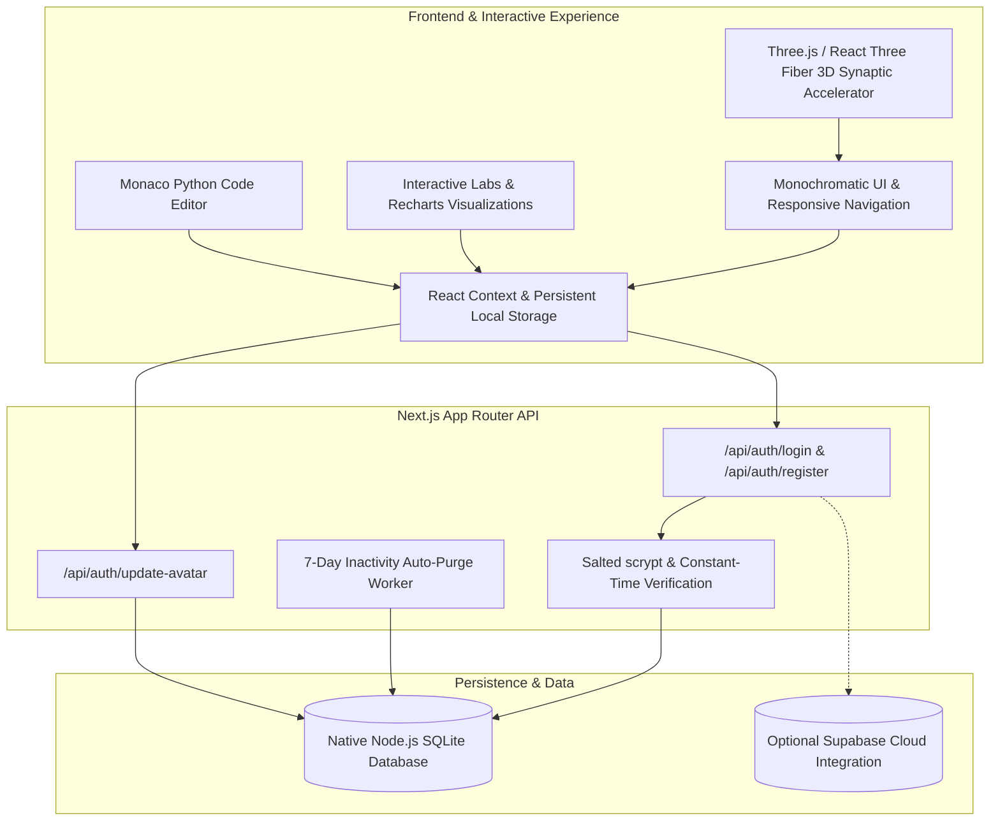
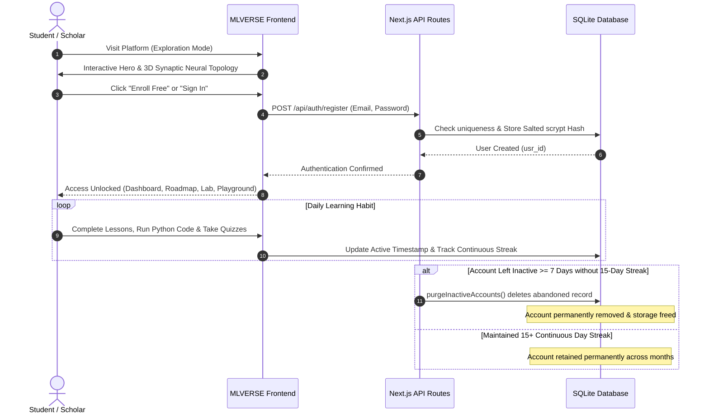

# MLVERSE — Interactive Machine Learning Platform

<div align="center">


**A futuristic, production-grade educational platform for mastering machine learning from first mathematical principles to real-world deployment.**

[Explore Modules](#-curriculum--learning-modules) • [Architecture](#-system-architecture) • [Workflow](#-platform-workflow) • [Key Features](#-core-features) • [Getting Started](#-getting-started)

</div>

---

## 📌 Problem Statement

Traditional machine learning education suffers from two extremes:
1. **Abstract Mathematical Textbooks**: High-density equations, proofs, and static diagrams that fail to build intuition for loss landscapes, decision boundaries, or gradient dynamics.
2. **Superficial "Black-Box" Tutorials**: Copy-pasting boilerplate library calls without understanding bias-variance trade-offs, regularization geometry, numerical stability, or model interpretability.

Furthermore, conventional learning platforms burden learners with cumbersome account recovery procedures, neglected legacy accounts, and passive video lectures with zero hands-on simulation.

---

## 💡 The MLVERSE Solution

**MLVERSE** redefines EdTech by merging rigorous mathematical theory with real-time 3D interactive graphics, live Python execution sandboxes, dynamic data exploration, and an active learning retention model:

* **Visual First Principles**: Understand algorithms by manipulating calculus surfaces, loss functions, decision contours, and 3D synaptic topologies in real time.
* **Hands-on Python Sandboxes**: Write, edit, and experiment with Python code using integrated Monaco code editors directly in the browser.
* **Strict Monochromatic Visual Identity**: Engineered with a high-contrast, minimalist `#000000` / `#FFFFFF` visual design system that eliminates visual noise and enhances focus.
* **Smart Account Lifecycle & Habit Formation**: Enforces a continuous 15-day monthly learning streak policy, automatically purging forgotten or abandoned accounts after 7 days of inactivity to keep database storage clean and free from obsolete credentials.

---

## 🏛️ System Architecture

MLVERSE is constructed on modern Next.js App Router architecture, leveraging built-in standard library utilities for speed, security, and minimal dependency overhead.



### Architectural Highlights
* **Zero-Dependency Native SQL**: Utilizes Node 22/24's built-in `node:sqlite` (`DatabaseSync`), eliminating bulky ORM overhead while retaining full relational capabilities.
* **Cryptographic Security**: Passwords are salted with 16-byte cryptographically secure random bytes and hashed using `scryptSync` (64-byte derived keys). Password verification uses `crypto.timingSafeEqual` to prevent timing attacks.
* **Progressive Hybrid Storage**: Student lesson progress, notes, bookmarks, and quiz scores persist immediately in local storage and can sync seamlessly with cloud storage.

---

## 🔄 Platform Workflow



---

## 🚀 Core Features

### 1. 3D Synaptic Accelerator Hero
* WebGL-powered 3D neural node cluster powered by **Three.js** and **React Three Fiber**.
* Interactive data nodes with fluid animations and responsive physics, visually representing neural connections.

### 2. Comprehensive Curriculum & Interactive Modules
* **Module 01**: Introduction to Machine Learning (AI vs ML hierarchies, function approximation, pipeline mechanics).
* **Module 02**: How Machine Learning Learns (Loss minimization, train/validation/test splits, No Free Lunch theorem).
* **Module 03**: Errors, Bias, Variance & Model Performance (Underfitting vs overfitting, bias-variance decomposition).
* **Module 04**: Calculus & Gradient Descent (Loss surfaces, partial derivatives, step size calibration, Adam optimizer).
* **Module 05**: Supervised Learning (Linear regression, logistic sigmoid mechanics, decision boundaries).
* **Module 06**: Tree-Based Models & Ensembles (Information gain, Gini impurity, Random Forests, Gradient Boosted Trees).
* **Module 07**: Neural Networks & Deep Learning (Perceptrons, backpropagation, activation functions, tensor transformations).
* **Module 08**: Model Validation & Evaluation Metrics (Confusion matrices, Precision, Recall, F1, ROC/AUC analysis).
* **Module 09**: Unsupervised Learning & Clustering (K-Means centroids, hierarchical clustering, PCA dimensionality reduction).
* **Module 10**: End-to-End Machine Learning Projects (Data hygiene, feature engineering, production deployment pipelines).

### 3. Executable Python Coding Lab
* Integrated **Monaco Editor** configured with syntax highlighting, indentation guides, and clean dark theme matching platform aesthetics.
* Pre-loaded runnable Scikit-learn, NumPy, and Pandas implementations for every topic.

### 4. Interactive Simulation & Data Viz Lab
* Real-time decision boundary playground with configurable noise and sample density.
* Loss surface 3D landscape explorer with gradient descent step visualization.
* Dynamic confusion matrix threshold tuner with instant ROC-curve plotting.

### 5. Habit Formation & Automated Account Retention
* **15-Day Monthly Streak Rule**: Encourages consistent daily learning habits by requiring at least 15 continuous active days per month.
* **Zero-Hassle 7-Day Purge**: Inactive accounts without the required streak are automatically removed after 7 days, eliminating stale credentials and allowing hassle-free re-registration without complex password reset flows.

### 6. Circular Avatar Uploader
* Interactive circular profile avatar with instant client-side preview.
* Autosaves profile images directly to the database and persistent student profile.

---

## 🛠️ Tech Stack & Libraries

| Domain | Technology |
|---|---|
| **Framework** | [Next.js 14](https://nextjs.org/) (App Router, Server & Client Components) |
| **Language** | [TypeScript 5](https://www.typescriptlang.org/) |
| **Styling** | [Tailwind CSS](https://tailwindcss.com/) (Custom Monochromatic Theme) |
| **3D Graphics** | [Three.js](https://threejs.org/) & [@react-three/fiber](https://docs.pmnd.rs/react-three-fiber/) |
| **Animation** | [Framer Motion](https://www.framer.com/motion/) |
| **Code Editor** | [@monaco-editor/react](https://github.com/suren-atoyan/monaco-react) |
| **Charts** | [Recharts](https://recharts.org/) |
| **Database** | Native Node.js `node:sqlite` (`DatabaseSync`) |
| **Cryptography** | Native `node:crypto` (`scryptSync`, `timingSafeEqual`) |
| **Icons** | [Lucide React](https://lucide.dev/) |

---

## 🏁 Getting Started

### Prerequisites
* **Node.js**: v20.14.0 or higher (Node 22 or 24 recommended for built-in SQLite support)
* **npm**: v10+

### Installation

1. **Clone the repository**:
   ```bash
   git clone https://github.com/your-username/mlverse.git
   cd mlverse
   ```

2. **Install dependencies**:
   ```bash
   npm install
   ```

3. **Run the development server**:
   ```bash
   npm run dev
   ```

4. **Open in browser**:
   Navigate to [http://localhost:3000](http://localhost:3000) to view the application.

### Running Test Suite
Execute the built-in assert-based automated test suite for database and authentication verification:
```bash
node --experimental-strip-types tests/auth_check.mjs
```

### Production Build
Compile and verify the optimized production build:
```bash
npm run build
npm run start
```

---

## 🔮 Future Scope & Roadmap

- [ ] **WebAssembly (Pyodide) Integration**: Execute full in-browser scientific Python scripts with client-side NumPy and Scikit-learn computations.
- [ ] **Custom Dataset Uploader**: Allow learners to import their own CSV datasets to test trained algorithms inside the Interactive Playground.
- [ ] **Interactive 3D Tensor Visualizer**: Real-time visualization of high-dimensional matrix multiplications and attention heads for Transformer architectures.
- [ ] **Peer Discussion & Code Snippet Sharing**: Community study halls for sharing notebook solutions, code snippets, and mathematical notes.
- [ ] **Verifiable Course Completion Certificates**: Cryptographically signed achievement badges and downloadable SVG/PDF course completion certificates.

---

## 📄 License

This project is licensed under the MIT License — see the [LICENSE](LICENSE) file for details.

---

<div align="center">
  <sub>Built with precision for machine learning enthusiasts, engineers, and researchers worldwide.</sub>
</div>

